# 🧪 Awesome Manual &amp; Exploratory Testing Tools 🎯

  

  
  
  
  
  

  <strong>🌟 A curated directory of top-tier Manual &amp; Exploratory Testing tools — featuring commercial SaaS test management solutions, session-based testing (SBTM) companions, open-source test runners, and browser extensions for unscripted QA, note-taking, and rapid evidence capture. 🚀</strong>

  ✨ <em>Star this repo if you find it helpful!</em> ✨

---

## 📋 Table of Contents 📑

- [📈 Sector Overview & Market Dynamics](#-sector-overview--market-dynamics)
- [🟦 SaaS / Hosted Platforms](#-saas--hosted-platforms)
- [🟩 Open-Source Software](#-open-source-software)
- [📊 Comparison at a Glance](#-comparison-at-a-glance)
- [💡 Key Exploratory Testing Concepts](#-key-exploratory-testing-concepts)
- [⭐ Star History](#-star-history)
- [💖 Support](#-support)
- [🤝 Contributing](#-contributing)
- [📄 License](#-license)

---

## 📈 Sector Overview & Market Dynamics 🌐

The global **Software Testing & QA Market** is estimated at **$54B–$63B** 💰 (projected to exceed **$95B+** by the early 2030s at an ~11% CAGR 🚀), with the dedicated **Test Management Software** segment representing approximately **$2.6B** 📊. The sector is **moderately fragmented** 🧩 — while enterprise conglomerates like Tricentis and Idera anchor the high-end centralized test management market through private-equity acquisitions 🏢, exploratory and session-based testing remains dynamically dispersed across specialized point tools 🎯, modern agile SaaS platforms ⚡, and community-driven open-source utilities 💻.

---

## 🟦 SaaS / Hosted Platforms ☁️

Commercial, cloud-hosted manual and exploratory testing suites sorted in descending order of company scale (valuation / annual revenue) 🏆.

| Platform 🛠️ | Company Scale (Valuation / Revenue) 🏢 | Starting Pricing (Specific Tier) 💳 | Free Tier / Free Trial Limits 🎁 | Key Capabilities & Highlights ✨ |
|:---|:---|:---|:---|:---|
| **[Tricentis qTest Explorer](https://www.tricentis.com/products/unified-test-management-qtest)** | **~$4.5B valuation** 🦄 (~$500M ARR; PE-backed by GTCR) | ~$83.33/user/month ($1,000/user billed annually) | 14-day free trial; full suite access (qTest Manager, Sessions, Launch, Explorer) | Automatic interaction capture (keystrokes, clicks, screens) generating descriptive natural-language test steps across web, desktop, and legacy enterprise GUIs. |
| **[Xray Exploratory App](https://www.getxray.app/exploratory-testing-app)** | **~$3.0B valuation** 🏢 (Parent: Idera, Inc. / Sembi; >$300M revenue) | Standalone desktop app: **$0** (Free). Jira Cloud integration: **$10/month flat** (1–10 users) or ~$7.28/user/month (11–100 tier) | **Free-forever standalone desktop app** (unlimited sessions, video/audio/screen annotation, local PDF export). For Jira integration: 30-day free trial on Atlassian Marketplace | Cross-platform desktop workspace (Windows, macOS, Linux) with integrated charter execution, rich audio/video screen recording, and direct Jira test run evidence sync. |
| **[TestRail Exploratory Testing](https://www.testrail.com)** | **~$3.0B valuation** 🏢 (Parent: Idera, Inc.; >$300M revenue; ~$10M–$15M standalone ARR) | **$22/user/month** (Essentials plan, billed annually; max 5 users) or $38/user/month (Professional plan) | 30-day free trial; includes full platform features, test case repositories, ad-hoc runs, and standard defect integrations (no credit card required) | Centralized exploratory session management alongside structured manual/automated test cases, providing unified QA metrics, traceability, and milestone reporting. |
| **[PractiTest Exploratory](https://www.practitest.com)** | **Bootstrapped / Profitable** 🌱 (~$1M–$5M ARR; self-sustaining, zero VC debt) | **$47/user/month** (Team plan, billed annually; 5-tester minimum license pack = $235/month) | 14-day free trial; full platform evaluation including Requirements, Test Library, Test Sets, Runs, SmartFox AI, and 5 read-only accounts (no credit card required) | End-to-end test management connecting exploratory sessions, requirement traceability, test runs, and custom bug workflows in one cross-project dashboard. |
| **[Testmo Exploratory](https://www.testmo.com)** | **Bootstrapped / Privately Held** 🚀 (Mid-market SaaS; ~hundreds of global teams) | **$59/month flat** (Team plan, includes up to 5 users, unlimited tests/projects) | 21-day free trial; complete feature access (test case management, exploratory runs, automation results, and optional sample demo projects) | Modern, ultra-fast test management pairing exploratory session charters and rich note/screenshot capture with manual tests and CI automation result pipelines. |

---

## 🟩 Open-Source Software 🔓

Self-hosted, community-driven manual and exploratory testing tools sorted by GitHub Stars_Count (descending) 🌟.

| Tool 🛠️ | GitHub_Stars ⭐ | Stack 💻 | License 📜 | Description & Exploratory Focus 🔍 |
|:---|:---:|:---|:---|:---|
| **[TestLink](https://github.com/TestLinkOpenSourceTRMS/testlink-code)** |  | PHP / MySQL / Web | GPL-2.0 | Veteran open-source test management web tool with extensive test specification trees, requirement linking, manual execution passes, and milestone tracking. |
| **[Kiwi TCMS](https://github.com/kiwitcms/kiwitcms)** |  | Python / Django / Docker | GPL-3.0 | The leading modern open-source test management system. Features full Docker containerization, manual test run coordination, bug tracker integrations, and extensive API automation. |
| **[Bug Magnet](https://github.com/gojko/bugmagnet)** |  | JavaScript / Chrome Ext | MIT | Exploratory testing assistant extension that injects boundary values, special Unicode chars, SQLi/XSS payloads, and edge cases directly into browser input fields. |
| **[TestPlanIt](https://github.com/TestPlanIt/testplanit)** |  | Next.js 16 / React 19 / Postgres | AGPL-3.0 | Modern full-featured test management platform where exploratory sessions, live note-taking, rich text test charters, and ad-hoc runs are treated as first-class citizens. |
| **[Suitest](https://github.com/suiflex/suitest)** |  | Python / FastAPI / React / MCP | Apache-2.0 | Self-hostable, MCP-native manual test management platform supporting local data persistence, test charters, Playwright/API execution, and optional LLM assistance. |
| **[Agentic Test Explorer](https://github.com/srbarrios/agentic-test-explorer)** |  | Python / LangChain / Playwright | MIT | AI-driven exploratory test framework that dynamically traverses web applications, executes session-based exploration, and flags unexpected UI bugs. |
| **[Exploratory Testing Extension](https://github.com/morvader/ExploratoryTestingChromeExtension)** |  | JavaScript / Chrome Web Ext | MIT | Browser extension built specifically for exploratory web testing: capture annotated screenshots, record URL history, log observations, and export markdown/HTML reports. |
| **[QA Trace](https://github.com/AnastasyaNN/QA-Trace)** |  | JavaScript / Web Extension | Open Source | Browser extension tracking user clicks, inputs, console errors, and network anomalies during exploratory sessions, exporting structured context for LLM bug triage. |
| **[Rapid Reporter](https://github.com/sgershon/Rapid-Reporter)** |  | Tauri / Rust / React | Open Source | The quintessential lightweight, always-on-top exploratory note-taking tool by Shmuel Gershon. Keeps focus squarely on testing while streaming markdown notes and screenshots. |
| **[Session Tester](https://github.com/testverkstaden/sessiontester)** |  | C# / .NET / WinForms | GPL-2.0 | Community continuation of Jonathan Kohl’s classic Session-Based Test Management (SBTM) application with session timer countdowns, charter priming, and HTML reports. |

---

## 📊 Comparison at a Glance 🔍

| Software 🛠️ | Delivery 📦 | Primary License 📜 | Session Management ⏱️ | Note-Taking 📝 | Evidence Capture 📸 | Target Platform 💻 |
|:---|:---|:---|:---:|:---:|:---:|:---|
| **Tricentis qTest Explorer** | SaaS / Desktop | Commercial | ✅ | ✅ Auto-generated steps | ✅ Screenshots & Video | Web & Windows Desktop |
| **Xray Exploratory App** | Desktop App / Cloud | Proprietary / Free Tier | ✅ | ✅ Markdown / Formatted | ✅ Audio / Video / Screen | Windows, macOS, Linux |
| **TestRail** | SaaS / Server | Commercial | ✅ | ✅ | ✅ File attachments | Cross-Platform (Web) |
| **PractiTest** | SaaS | Commercial | ✅ | ✅ Rich text | ✅ File attachments | Cross-Platform (Web) |
| **Testmo** | SaaS | Commercial | ✅ | ✅ Rich text | ✅ Screenshots & Video | Cross-Platform (Web) |
| **TestLink** | Self-Hosted | GPL-2.0 | ⚠️ Via test execution | ✅ | ✅ File attachments | Web (PHP/MySQL) |
| **Kiwi TCMS** | Self-Hosted / Docker | GPL-3.0 | ✅ Via test runs | ✅ | ✅ Attachments & Bug links | Web (Docker/Django) |
| **Bug Magnet** | Browser Extension | MIT | ❌ | ❌ | ❌ | Chrome, Edge, Firefox |
| **TestPlanIt** | Self-Hosted / Cloud | AGPL-3.0 | ✅ Native sessions | ✅ First-class notes | ✅ Media attachments | Web (Docker/Node.js) |
| **Suitest** | Self-Hosted | Apache-2.0 | ✅ | ✅ | ⚠️ Via MCP integrations | Web & Local APIs |
| **Agentic Test Explorer** | CLI / Script | MIT | ✅ Automated charters | ✅ Structured logs | ✅ Playwright traces | Python / CLI |
| **Exploratory Testing Ext.** | Browser Extension | MIT | ✅ Lightweight | ✅ Session notes | ✅ Annotated screenshots | Chrome Browser |
| **QA Trace** | Browser Extension | Open Source | ✅ Action tracking | ⚠️ Prompt generation | ✅ Error logs & captures | Chrome & Firefox |
| **Rapid Reporter** | Desktop App | Open Source | ⚠️ Note logging | ✅ Markdown-first | ✅ Screenshots | Windows, macOS, Linux |
| **Session Tester** | Desktop App | GPL-2.0 | ✅ SBT Timer & XML | ✅ Session notes | ❌ | Windows Native |

---

## 💡 Key Exploratory Testing Concepts 🧠

- **⏱️ Session-Based Test Management (SBTM):** A structured method of exploratory testing developed by James & Jonathan Bach that uses uninterrupted time-boxed sessions focused on a clear test charter.
- **🎯 Test Charter:** A clear mission statement defining what area, feature, or risk is being explored, with what tooling, and what questions to answer.
- **🐛 Edge-Case & Boundary Injection:** Deliberately testing unicode boundaries, null values, script tags, string formatting, and maximum input sizes to detect unhandled exceptions.
- **📸 Evidence-Driven Defect Reporting:** Generating bug reports with step-by-step reproduction logs, screenshots, HAR files, and video captures directly recorded during the exploration session.

---

## 🌟 Star History

---

## 💖 Support & Community

Thank you so much for exploring this curated repository! 🙌 If this list helped streamline your QA workflow, save time selecting tools, or level up your exploratory testing practices, please consider supporting the project:

- ⭐ **Star** this repository to show your appreciation and help other QA engineers discover it.
- 🍴 **Fork** and contribute any missing tools or workflow tips via pull requests.
- 📢 **Share** it with your testing teams, QA communities, and on social media.
- ☕ **Buy a Coffee / Sponsor:** You can support ongoing maintenance and new curated resources via the **[GitHub Sponsors Dashboard](https://github.com/sponsors/ishandutta2007)**. Every contribution is deeply appreciated! 💙

---

## 🤝 Contributing 🤝

Contributions are always welcome! 🎉 To add a new manual or exploratory testing tool, open a pull request adhering to these guidelines:
1. Ensure the tool has active development and is directly relevant to manual/exploratory testing or session-based test management.
2. Provide accurate pricing, license, and repository links.
3. Keep entries concise, objective, and sorted according to the established section criteria.

---

## 📄 License 📜

To the extent possible under law, the authors and contributors have waived all copyright and related or neighboring rights to this work under **CC0 1.0 Universal**.
